<p align="center">
  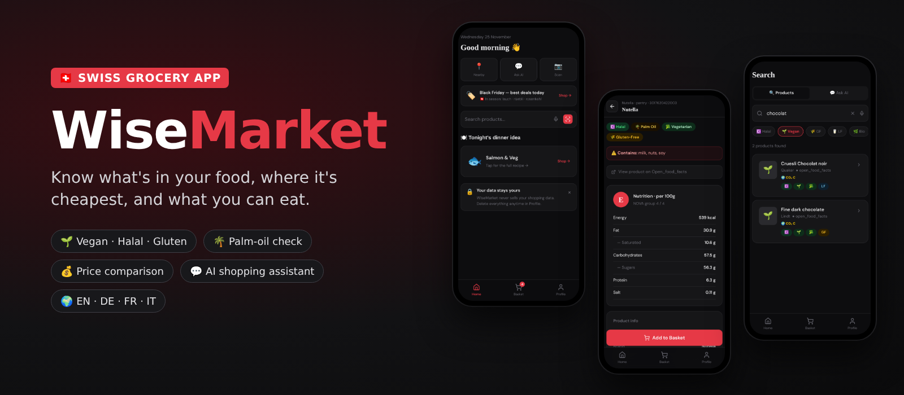
</p>

<p align="center">
  <a href="https://github.com/AbdulbariSoliman/wisemarket/actions/workflows/ci.yml"></a>
  
  
  
  
  
  
  
  
  
</p>

<p align="center">
  <a href="https://wisemarket-6ib3.onrender.com"></a>
</p>
<p align="center"><sub>Free hosting: the first visit after a quiet period takes up to a minute while the server wakes up.</sub></p>

# WiseMarket 🇨🇭

**A Swiss grocery app that knows what's in your food, where it's cheapest, and what you can eat, in English, German, French and Italian.**

**Live app: [wisemarket-6ib3.onrender.com](https://wisemarket-6ib3.onrender.com)**, best on a phone, and installable as an app from the browser menu.

Search or scan a product, compare its price across stores, see at a glance whether it is vegan, vegetarian, halal, gluten-free or lactose-free and whether it contains palm oil, and ask an AI assistant about your shopping in plain language.

### Highlights

- 🧪 **Explainable ingredient analysis.** Every verdict comes with the exact ingredients that caused it, from 67 multilingual word lists.
- 🎯 **Measured accuracy.** False "vegan" claims fell from 19 to 0 on 100 real products, and 7,255 products were corrected in the live catalogue.
- 🤖 **AI agent grounded in data.** The LLM detects intent and writes the answer, but every price and product comes from Postgres.
- 🛡️ **Safety first.** Automated re-tagging can only make a tag stricter; "this is safe" changes go to human review.
- ✅ **Tested and shipped.** 240 tests, CI with integration tests against a fresh Supabase instance on every push, and a Docker deployment that goes live automatically.

---

**Contents:** [What it does](#what-it-does) · [How it works](#how-it-works) · [AI agent](#the-ai-agent) · [Ingredient analysis](#ingredient-analysis) · [API](#api) · [Design decisions](#design-decisions) · [Data](#data-sources) · [Screens](#screens) · [Quick start](#quick-start) · [Deploy](#deploy-one-service-free) · [Tests](#testing-and-ci) · [Structure](#project-structure) · [Tech stack](#tech-stack) · [Limitations](#known-limitations) · [Roadmap](#roadmap)

---

## What it does

Every feature links straight to that screen in the live app.

| Feature | What the user gets | Try it |
|---|---|---|
| 🔍 **Search** | Products in 4 languages, with filters: halal, vegan, gluten-free, lactose-free, bio, protein, low sugar | [Search ↗](https://wisemarket-6ib3.onrender.com/search) |
| 🧪 **Ingredient analysis** | Vegan, vegetarian, halal, gluten, lactose, palm-oil and allergen verdicts from the real ingredient list | [Nutella ↗](https://wisemarket-6ib3.onrender.com/product/3017620422003) |
| 💰 **Price comparison** | The same product across stores, total price and price per 100 g/ml | [Whole Milk ↗](https://wisemarket-6ib3.onrender.com/product/7610000100001) |
| 🛒 **Smart basket** | Cheapest mix across stores or cheapest single store, savings, budget, nutrition summary, **PDF shopping list** | [Basket ↗](https://wisemarket-6ib3.onrender.com/basket) |
| 📷 **Barcode scan** | Scan with the camera, or type the number under the barcode | [Scan ↗](https://wisemarket-6ib3.onrender.com/scan) |
| 💬 **Ask AI** | "Where is oat milk cheapest?", "Is Nutella halal?", "What's on sale?", answered from the database, in your language | [Chat ↗](https://wisemarket-6ib3.onrender.com/chat) |
| 🔥 **Deals and seasonal produce** | Current promotions, Swiss produce in season, a dinner idea with recipe | [Home ↗](https://wisemarket-6ib3.onrender.com/) |
| 📍 **Nearby stores** | Migros, Coop, Aldi, Lidl and Denner within 2 km (OpenStreetMap) | [Stores ↗](https://wisemarket-6ib3.onrender.com/stores) |
| ⚙️ **Personal settings** | 4 languages, dark/light mode, dietary profile that filters search; stored on the device, no account | [Settings ↗](https://wisemarket-6ib3.onrender.com/settings) |
| 📖 **API docs** | Interactive OpenAPI documentation for every endpoint | [/api/docs ↗](https://wisemarket-6ib3.onrender.com/api/docs) |

---

## How it works

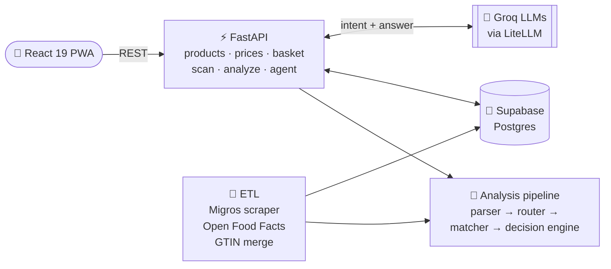

The rule behind the design: **anything that must be correct is plain code; the LLM only handles language.** Prices, basket totals, barcode lookups and dietary verdicts are deterministic and testable. The language model understands the question and writes the answer, but every fact it states comes from the database.

---

## The AI agent

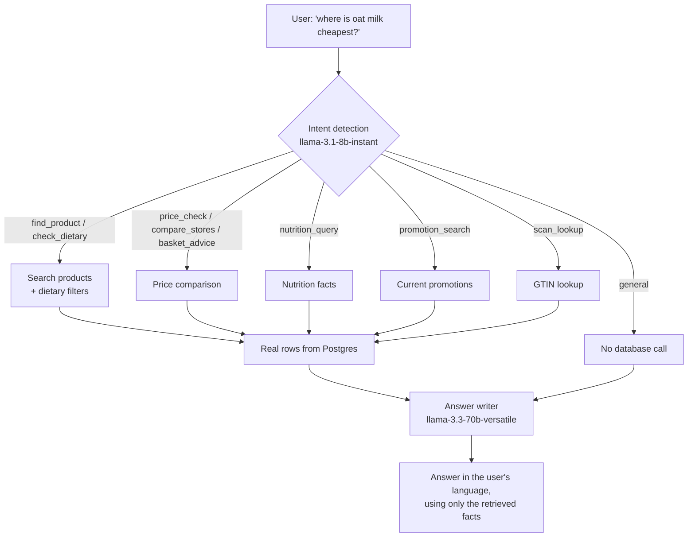

- **9 intents**, detected by a small, fast model. If it is unsure, a keyword fallback still extracts the search term ("oat milk" from "where is oat milk cheapest?").
- **Database tools** return real products, prices and promotions. The answer model is instructed to use only those facts, so there are no invented prices.
- If the database or the LLM is unavailable, the user gets a **friendly, translated error** instead of a crash.
- Models are configurable through environment variables (`LLM_INTENT_MODEL`, `LLM_REFINER_MODEL`, `LLM_FALLBACK_MODEL`).

---

## Ingredient analysis

Every product with an ingredient list runs through the same four-step pipeline, in the API (`/analyze/{gtin}`), in the search tags and in the ETL:

1. **Parser:** splits the list (keeping decimal commas like `7,4 %` intact), keeps sub-ingredients in brackets, strips quantities, recognises "may contain…" trace statements in 4 languages, and fixes common scan errors (`SeeIachs` → `Seelachs`, `oeuf`/`œuf`, `&lt;`).
2. **Router:** chooses which word lists to check for the product's category. Safety lists (meat, fish, alcohol, gluten, palm oil…) are always checked.
3. **Matcher:** finds terms from **67 multilingual ontology files** (`data/ontology/`). It handles German compound words (`Vollmilchpulver` → milk), plurals (`maquereaux`), negations (`sans huile de palme`), and plant look-alikes (`beurre de cacao`, `lait de coco`).
4. **Decision engine:** turns the matches into verdicts:

| Verdict | Rule |
|---|---|
| Vegan | No milk, egg, honey, meat, fish, gelatine… (traces alone don't count) |
| Vegetarian | No meat, fish, gelatine or lard |
| Halal | No pork or alcohol; meat and gelatine only with a halal label (in the ingredients or the product name); fish is fine |
| Gluten-free | No wheat, rye, barley, spelt, oats, seitan… (traces count) |
| Lactose-free | No dairy ingredient, or labelled lactose-free |
| Palm oil | Palm oil, palm fat or palm kernel oil found |

Lists in languages the ontology doesn't cover (for example Spanish or Czech) are detected and **left untagged** rather than guessed. Products with no ingredient list at all (most Migros items) get tags from their **name** only, and only when the name proves them.

### Measured on real data

| Check | Before | After |
|---|---:|---:|
| False "vegan / likely vegan" claims, 100 real Open Food Facts products | 19 | **0** |
| Missed palm oil, same 100 products | 13 | **0** |
| Palm-oil false alarms, same 100 products | 0 | **0** |
| Stored tags corrected in the live catalogue (7,959 products with ingredients) | – | **7,255 products** |

Corrections in the live catalogue included about 2,000 products wrongly listed as vegan, 1,340 as gluten-free, 1,090 as halal and 790 as vegetarian, plus about 700 newly detected palm-oil products.

The backfill (`scripts/recompute_tags.py`) applies only changes that make a tag **stricter**. Changes that would declare a product *safer* (e.g. not halal → halal) are listed for human review, because wrongly calling a product safe is the harmful mistake.

### Example: one product, fully explained

`GET /analyze/3017620422003` (Nutella), shortened:

```json
{
  "name": "Nutella",
  "ingredients_raw": "Sucre, huile de palme, NOISETTES 13%, cacao maigre 7,4%, LAIT écrémé en poudre 6,6%, LACTOSERUM en poudre, émulsifiants: lécithines [SOJA), vanilline. Sans gluten.",
  "ingredients_parsed": ["sucre", "huile de palme", "noisettes", "cacao maigre", "lait écrémé en poudre",
                         "lactoserum en poudre", "émulsifiants: lécithines", "vanilline sans gluten", "soja"],
  "verdicts": {
    "vegan": false,
    "vegetarian": true,
    "halal": true,
    "is_gluten_free": true,
    "is_lactose_free": false,
    "has_palm_oil": true,
    "allergen_warning": true,
    "reasons": {
      "animal_hits":      ["lait écrémé en poudre", "lactoserum en poudre"],
      "palm_oil_hits":    ["huile de palme"],
      "allergen_hits":    ["noisettes", "lait écrémé en poudre", "soja"],
      "gluten_free_hits": ["vanilline sans gluten"]
    },
    "packages": [
      {"id": "halal",            "label": "Halal",              "confidence": "high"},
      {"id": "vegetarian",       "label": "Vegetarian",         "confidence": "high"},
      {"id": "gluten_free",      "label": "Gluten Free",        "confidence": "high"},
      {"id": "allergen_warning", "label": "Contains Allergens", "confidence": "high"},
      {"id": "palm_oil",         "label": "Contains Palm Oil",  "confidence": "high"}
    ]
  }
}
```

Every verdict can be traced back to the ingredient that caused it, which is what makes it possible to debug and trust.

---

## API

Interactive docs at `http://localhost:8000/docs` once the backend runs.

| Method | Endpoint | Purpose |
|---|---|---|
| `GET` | `/products/search?q=&vegan=&halal=&gluten_free=&lactose_free=` | Search with dietary filters |
| `GET` | `/products/{gtin}` | Product detail, all stores, unified record |
| `GET` | `/products/{gtin}/nutrition` | Nutrition facts |
| `GET` | `/analyze/{gtin}` | Full ingredient analysis with reasons (60 requests/min) |
| `GET` | `/prices/compare/{gtin}` | Price per store, per 100 g/ml |
| `GET` | `/prices/history/{gtin}` · `/prices/latest/{gtin}` | Price history and latest price |
| `GET` | `/promotions` | Current deals |
| `POST` | `/basket/calculate` | Cheapest mix or cheapest single store |
| `POST` | `/basket/nutrition` · `/basket/export` | Basket nutrition summary · PDF shopping list |
| `POST` | `/scan` | Barcode → product and prices |
| `POST` | `/agent/query` | Ask the AI assistant |
| `GET` | `/health` | Health check |

Database and network errors return clear `503`/`502` responses instead of stack traces, and CORS is restricted to the configured frontend origins.

---

## Design decisions

| Decision | Why |
|---|---|
| **Rules for facts, LLM for language** | Prices and dietary verdicts must be exact and testable; LLMs are good at understanding questions, not at being a source of truth. |
| **Ontology files instead of a model for ingredients** | 67 readable CSV word lists in 4 languages can be reviewed, extended and tested line by line, and every verdict can be explained. |
| **"Unknown" over "guessed"** | Labels in unsupported languages are left untagged instead of risking a wrong "vegan" or "halal". |
| **Strict-only automatic updates** | Re-tagging may tighten a tag automatically, but loosening one requires review. |
| **Source label on every field** | Merged products show which value came from the retailer, from Open Food Facts, or was computed. |
| **Two model sizes** | A fast 8B model classifies the intent; a 70B model writes the answer, with automatic fallback. |
| **No account needed** | Preferences and basket live on the device: private by default, and easy to try. |

---

## Data sources

| Source | What it provides | How |
|---|---|---|
| **Migros** | Real Swiss prices, pack sizes, images (~3,850 products) | Playwright scraper |
| **Open Food Facts** | Ingredients, allergens, nutrition (~9,500 products) | Public API |
| **Unified products** | Both of the above for the same barcode (~630 products) | GTIN merge, with a source label on every field |

Where a product exists in both sources, the app shows Migros prices **and** Open Food Facts ingredients. Every field records where it came from (`migros`, `open_food_facts` or `computed`), so third-party data is never presented as the retailer's own.

---

## Screens

| | | | | |
|:-:|:-:|:-:|:-:|:-:|
| 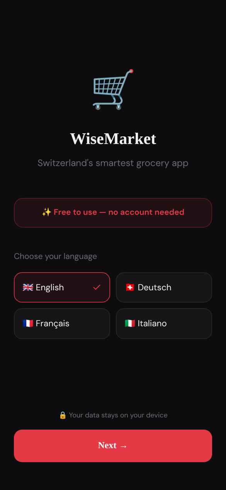<br>**Onboarding** | 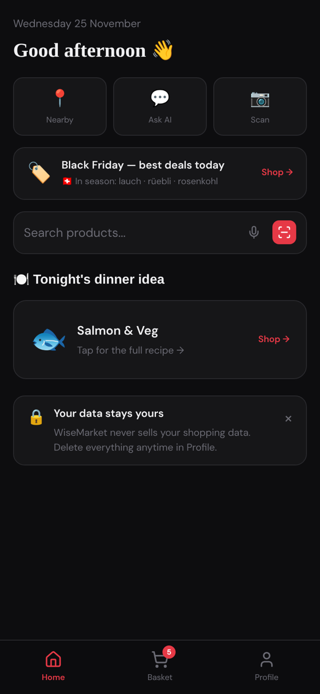<br>**Home** | 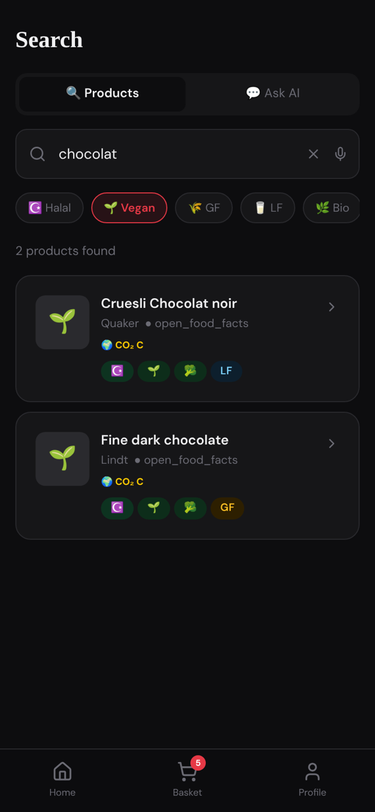<br>**Search**, vegan filter | 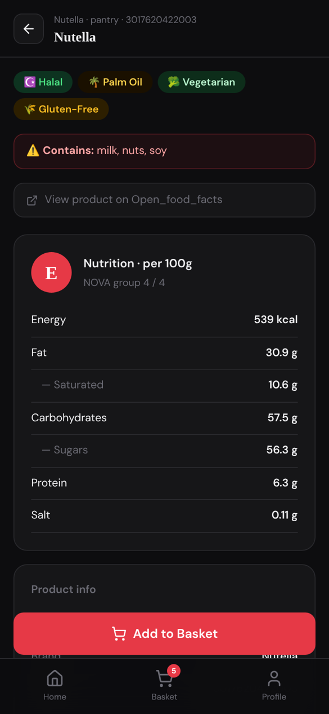<br>**Product analysis** | 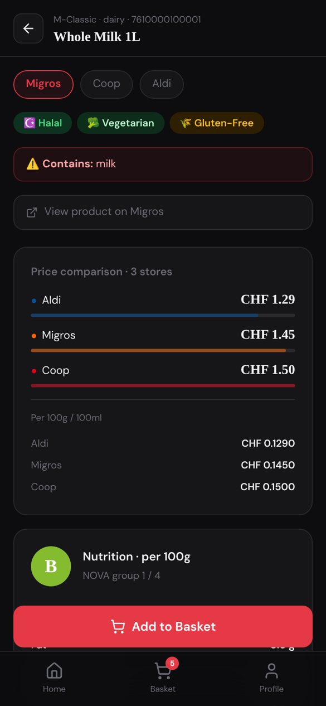<br>**Price comparison** |
| 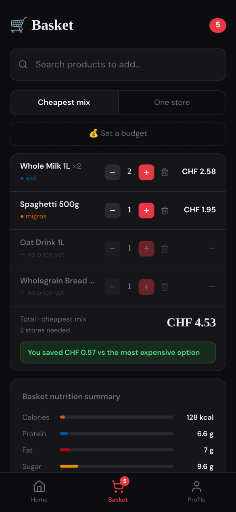<br>**Basket**, cheapest mix | 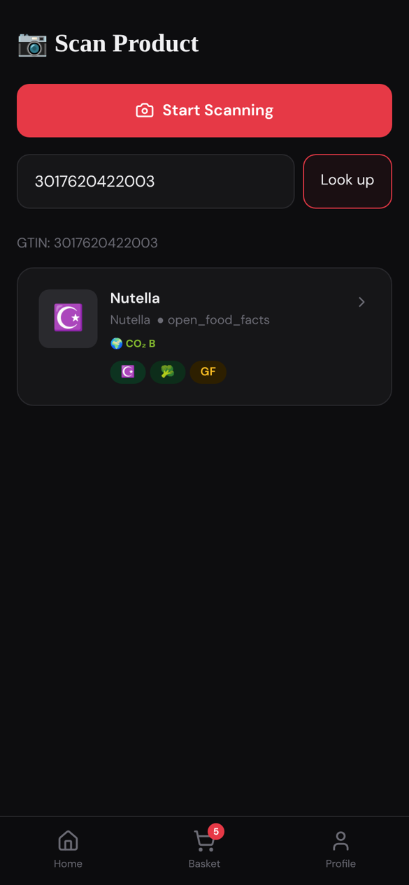<br>**Scan** | 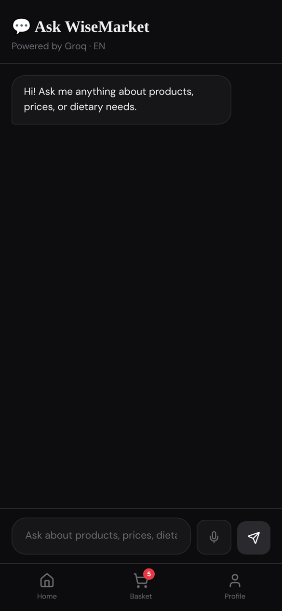<br>**Ask AI** | 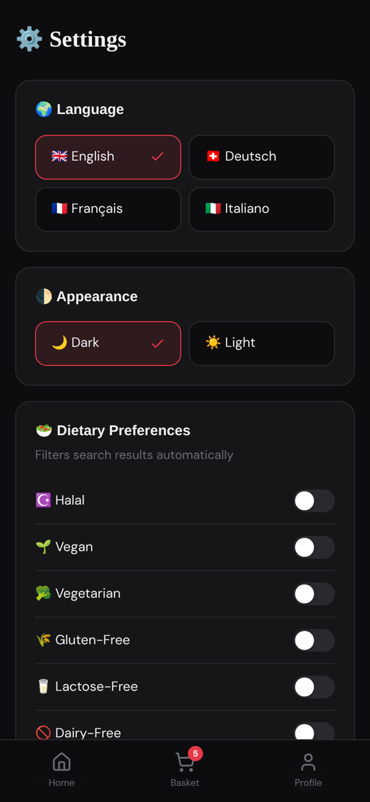<br>**Settings** | 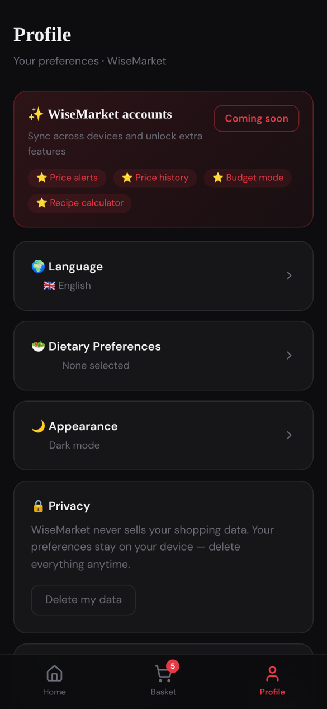<br>**Profile** |

Screenshots come from the production build (the same Docker image that runs live), with the test dataset: seed prices for Migros, Coop and Aldi, plus real Open Food Facts products. A page-by-page description is in [docs/APP_GUIDE.md](docs/APP_GUIDE.md).

---

## Quick start

**Requirements:** Python **3.11–3.13** (some pinned packages don't build on 3.14 yet), Node 20+, and a Supabase project (free tier is enough). A Groq API key is optional and only needed for the chat.

```bash
git clone https://github.com/AbdulbariSoliman/wisemarket.git
cd wisemarket
cp .env.example .env        # fill in SUPABASE_URL, SUPABASE_KEY, GROQ_API_KEY
pip install -r requirements.txt
```

**Database:** run these in the Supabase SQL Editor (or with `psql`), in order:

```
backend/schema/schema.sql
backend/schema/migrations/002_unified_merge_fields.sql
backend/schema/migrations/003_seed_ontology_versions.sql
```

Check the connection, then start the API:

```bash
python scripts/check_connection.py
uvicorn backend.api.main:app --reload          # http://localhost:8000/docs
```

Start the frontend:

```bash
cd frontend/wisemarket
npm install
npm run dev                                    # http://localhost:5173
```

**Load products** (optional):

```bash
pip install -r requirements-etl.txt
python -m backend.etl.ingest_open_food_facts
python scripts/recompute_tags.py               # preview; add --apply to write
```

### Deploy (one service, free)

**Running live at [https://wisemarket-6ib3.onrender.com](https://wisemarket-6ib3.onrender.com)**: Render builds the `Dockerfile` on every push to `main` and switches over when the health check passes.

The `Dockerfile` builds the React app and serves it together with the API from one container: the app at `/`, the API at `/api`. There is one URL and no CORS setup.

1. On [render.com](https://render.com): **New → Blueprint** → connect this repository (it reads `render.yaml`).
2. Enter `SUPABASE_URL`, `SUPABASE_KEY` and, optionally, `GROQ_API_KEY` when asked.
3. Deploy. The app runs at `https://<service-name>.onrender.com`, with the API docs at `/api/docs`.

On the free plan the service sleeps after 15 minutes without visitors; the first visit after that takes about a minute.

Run the same production setup locally:

```bash
cd frontend/wisemarket && npm run build && cd ../..
uvicorn backend.api.serve:app --port 8000      # app + API on http://localhost:8000
```

> 🔐 Keep `.env` out of git (it is in `.gitignore`). Never put the Supabase `service_role` key in frontend code.

---

## Testing and CI

| Suite | Command | Tests |
|---|---|---|
| Logic (no database) | `pytest -m "not integration"` | 196 |
| Integration (real API + Postgres) | `pytest -m integration` | 44 |
| Frontend | `npm run lint && npm run build` | ESLint + Vite build |

The logic suite includes **real product cases** taken from Open Food Facts: scanned labels with OCR errors, plurals, multilingual "may contain" statements, Croatian and Czech labels that must be left untagged, and more.

**CI** (`.github/workflows/ci.yml`) runs on every push and pull request with 3 jobs:
1. Logic tests
2. Integration tests against a **fresh local Supabase** (schema, all migrations and seed data), so production data is never touched
3. Frontend lint and build

---

## Project structure

```
wisemarket/
├── backend/
│   ├── api/            FastAPI app, routes, DB client, error handling, serve.py (production)
│   ├── services/       agent, LLM client, parser, router, matcher, decision engine, product tags
│   ├── etl/            Open Food Facts ingest, Migros scraper, GTIN merge
│   ├── normalizer/     ontology loader
│   └── schema/         schema.sql + migrations/
├── data/ontology/      67 multilingual CSV word lists (en/de/fr/it)
├── frontend/wisemarket React 19 + Vite PWA
├── scripts/            recompute_tags.py, check_connection.py
├── tests/              240 tests (logic + integration)
├── docs/               APP_GUIDE.md, BUILD_LOG.md, screenshots/
├── Dockerfile          builds the app and the API into one container
└── render.yaml         one-click deploy on Render
```

### Tech stack

| Area | Tools |
|---|---|
| **Frontend** | React 19 · Vite 8 · React Router 7 · Tailwind CSS 4 · Framer Motion · Lucide icons · ZXing (barcode scanning) · Web Speech API (voice input) · Service Worker + Web App Manifest (installable PWA) |
| **Backend** | Python 3.12 · FastAPI · Uvicorn · Pydantic · slowapi (rate limiting) · ReportLab + qrcode (PDF export) · Sentry (error tracking, optional) |
| **AI** | LiteLLM · Groq (`llama-3.1-8b-instant` for intent, `llama-3.3-70b-versatile` for answers, automatic fallback) · intent → tool → answer agent design |
| **Food analysis** | Rule-based NLP pipeline (parser, router, matcher, decision engine) · 67 multilingual ontology files (EN/DE/FR/IT) |
| **Data** | Supabase · PostgreSQL · PostgREST · SQL migrations · Row Level Security |
| **Data engineering** | Playwright (Migros scraper) · Open Food Facts API · GTIN-based merge with source tracking · idempotent backfill scripts |
| **Deployment** | Docker (multi-stage build: Node → Python) · Render (Blueprint, Frankfurt, auto-deploy on push) · health checks |
| **Quality** | pytest (240 tests: 196 logic, 44 integration) · ESLint · GitHub Actions CI · Supabase CLI (fresh database in CI) |
| **Developer tools** | Git · GitHub · GitHub Codespaces · VS Code · Mermaid (diagrams) |
| **External APIs** | Groq · Open Food Facts · OpenStreetMap Overpass |

---

## Known limitations

- **No per-user security yet.** Row Level Security is enabled but has no policies, and the API uses the `service_role` key. Real user accounts (Supabase Auth plus RLS policies) are the next big step.
- **Migros products have no ingredients of their own.** Only the ~630 products matched with Open Food Facts get a full analysis. For the others, the app shows only what the name proves: "Butter Cookies" is *not vegan*, "glutenfrei" is *gluten-free*, and everything else stays *unknown*, with no badge, rather than guessed.
- **Halal is ingredient-based, not a certification.** The app flags pork, alcohol and unlabelled meat or gelatine; it cannot verify slaughter or certification.
- **Only English, German, French and Italian labels are analysed.** Other languages are left untagged.
- **Some tag changes are held for review** (the "loosening" changes from the backfill); those products keep their stricter tags until reviewed.
- **Nearby stores** depend on the free public OpenStreetMap servers. The app tries three of them, but when all are busy it asks you to try again later.
- **Prices for Coop, Aldi and Lidl are sample data** for now; live prices come from Migros.
- **Free hosting sleeps** after 15 minutes without visitors, so the first request then takes up to a minute.

---

## Roadmap

1. Supabase Auth with RLS policies (public catalogue, private user data)
2. Coop, Aldi, Lidl and Denner scrapers feeding the same GTIN merge
3. More products matched with Open Food Facts for Migros items
4. A review screen for held tag changes
5. Price-history charts and price alerts

---

## Author

**Abdulbari Soliman**, AI & Data Engineer: end-to-end AI products, from data to deployed app
[GitHub](https://github.com/AbdulbariSoliman) · [LinkedIn](https://www.linkedin.com/in/abdulbari-soilman/)

Licensed under the [MIT License](LICENSE).
