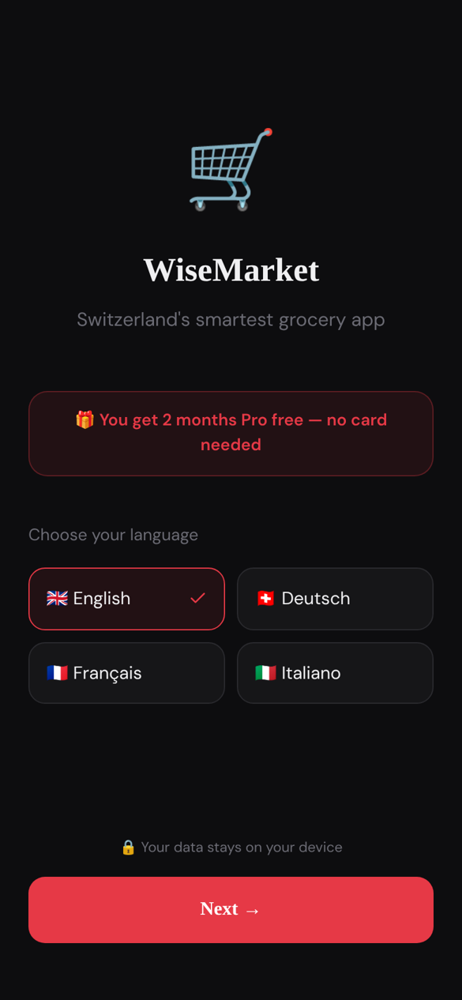
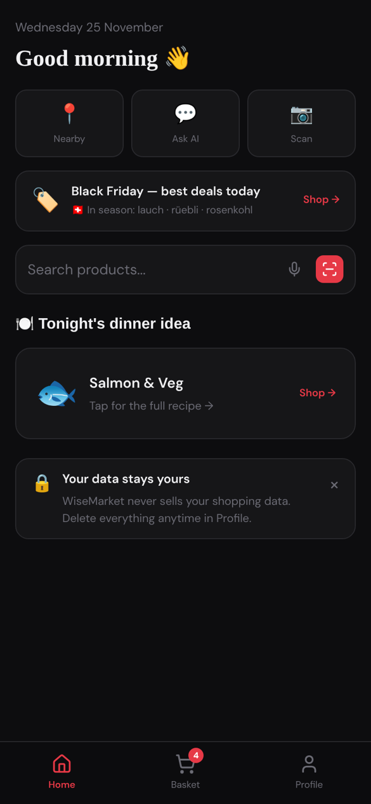
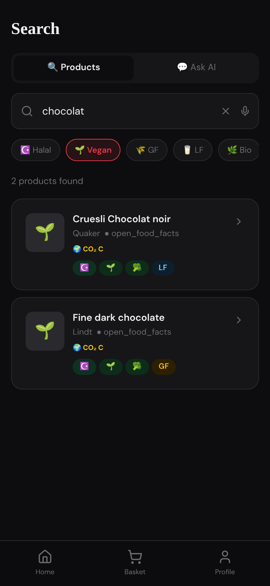
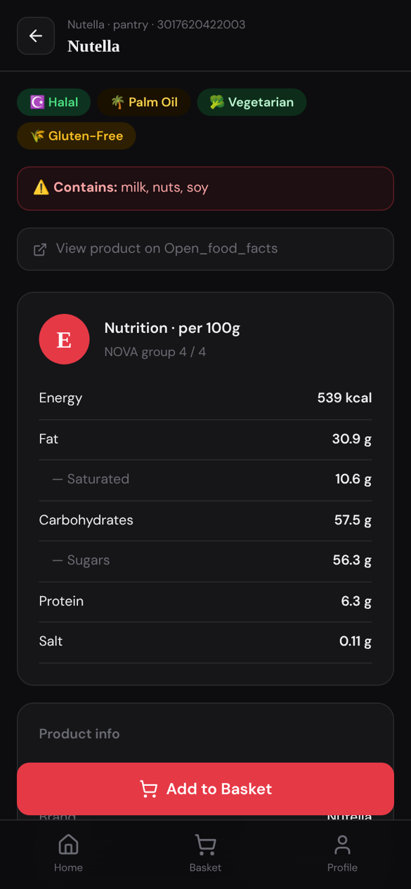
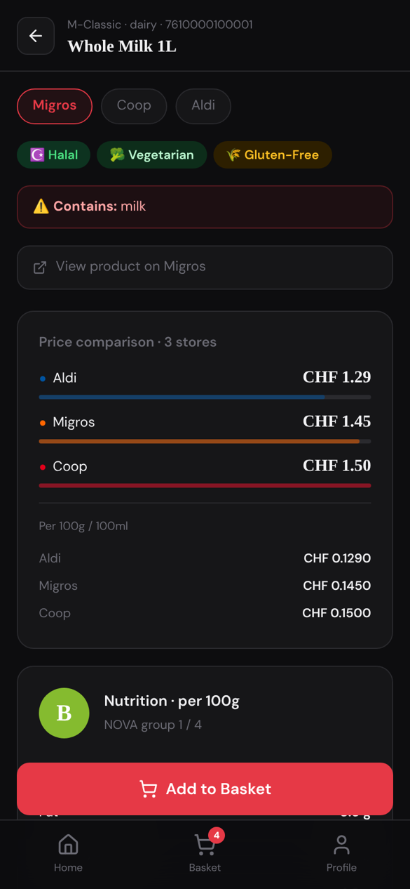
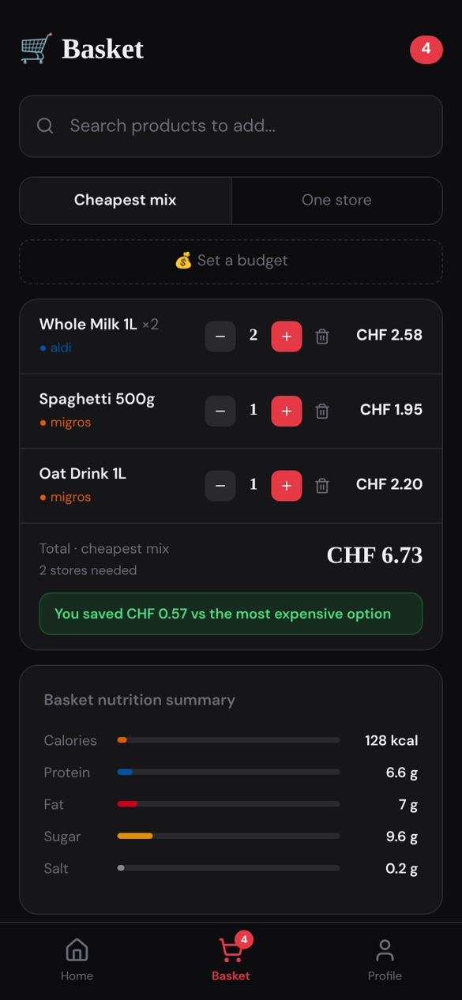
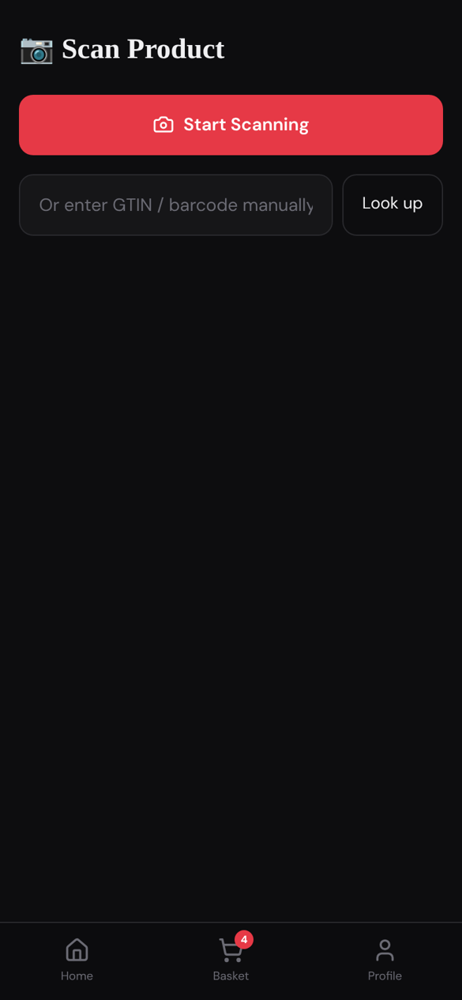
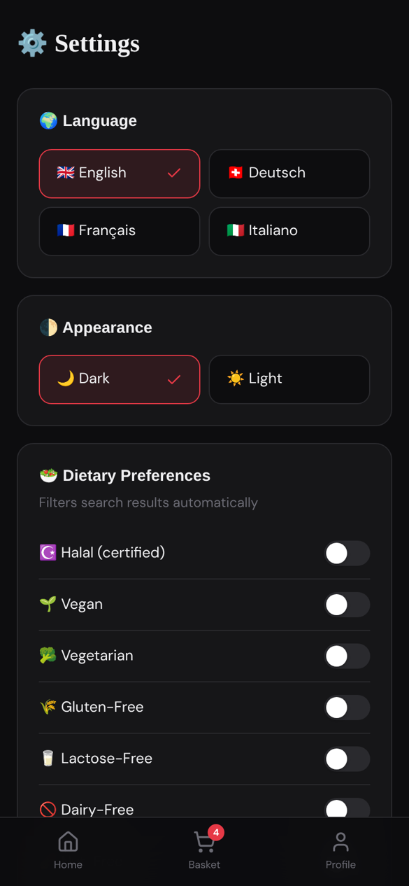

# WiseMarket: app guide

A short tour of every screen and what happens behind it.

---

## Onboarding

The first screen on a new device. The user picks a language (English, Deutsch, Français, Italiano). The choice is saved on the device and can be changed later in **Settings**.

No account or e-mail is needed to use the app.

 

---

## Home

- **Quick actions:** nearby stores, Ask AI, scan.
- **Deals banner** and seasonal Swiss produce (for example *Lauch, Rüebli, Rosenkohl* in November).
- **Search box** with voice input and a scan button.
- **Tonight's dinner idea:** a recipe suggestion that opens a full recipe page.
- **Privacy note:** shopping data stays on the device.

 

---

## Search

Search in any of the 4 languages and filter by **Halal, Vegan, Gluten-free, Lactose-free, Bio**. Each result shows the brand, source, CO₂ score and small tag icons.

The filters use tags computed from each product's **real ingredient list** (see the main README, *Ingredient analysis*). In the screenshot, "chocolat" returns 10 products; with **Vegan** on, only the 2 truly vegan dark chocolates remain.

The **Ask AI** tab sends the same box to the chat assistant.

 

---

## Product

- **Verdict badges:** Halal, Vegan, Vegetarian, Gluten-free, Lactose-free, and a 🌴 **Palm oil** warning.
- **Allergens:** "Contains: milk, nuts, soy".
- **Nutrition per 100 g** with Nutri-Score and NOVA group.
- **Ingredients** as printed on the pack, plus the product name in all 4 languages.
- A link to the product at the store or on Open Food Facts.
- **Add to basket.**

 

---

## Price comparison

When a product is sold in several stores, the product page shows a tab per store and a comparison chart: total price and **price per 100 g/ml**, cheapest first.

(Live prices currently come from Migros; the screenshot uses test prices for Migros, Coop and Aldi.)

 

---

## Basket

- Add products from search or the product page, or with the search box at the top.
- **Cheapest mix:** each item from the store where it is cheapest, with the total and the saving against the most expensive option.
- **One store:** the cheapest single store for the whole list.
- **Budget**, a **nutrition summary** for the whole basket, and **PDF export** of the shopping list.

 

---

## Scan

Opens the camera and reads EAN/UPC barcodes. The product page opens automatically. Without a camera, type the GTIN (the number under the barcode) and tap **Look up**.

 

---

## Ask WiseMarket (chat)

The assistant answers questions such as:

- "Where is oat milk cheapest?"
- "Is Nutella halal?"
- "How much protein is in skyr?"
- "What's on sale today?"

It detects the intent, fetches real products, prices or promotions from the database, and writes an answer in the user's language using **only those facts**. It needs a Groq API key on the server (`GROQ_API_KEY`); without one, the chat replies with a short "please try again" message instead of crashing.

---

## Nearby stores

Shows Migros, Coop, Aldi, Lidl and Denner supermarkets within 2 km, using the device location and OpenStreetMap, sorted by distance and with opening hours where available.

---

## Profile and Settings

- **Language** and **appearance** (dark/light).
- **Dietary preferences** (Halal, Vegan, Vegetarian, Gluten-free, Lactose-free, Dairy-free…), which filter search results automatically.
- **Privacy:** "Delete my data" clears everything stored on the device.

 
